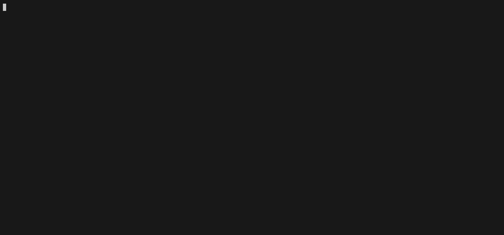

# finalproject_Sirotkin_M26-555

ValutaTrade Hub — учебное консольное приложение для регистрации пользователей,
ведения виртуальных валютных кошельков и получения курсов через CoinGecko
и ExchangeRate-API. Проект оформлен как устанавливаемый Python-пакет.

## Установка и запуск

Нужны Python 3.12 или новее и uv. В каталоге склонированного проекта выполните:

```sh
uv sync
uv run project
```

Команды ниже вводятся внутри приложения после приглашения `>`. Завершение —
Ctrl+D или Ctrl+C. Запускайте приложение из корня проекта, чтобы оно прочитало
настройки из `pyproject.toml`; пути к данным и логам относятся к текущему каталогу.

## API-ключи и обновление курсов

Получите ключ [ExchangeRate-API](https://www.exchangerate-api.com/) и задайте
переменную окружения перед запуском:

```sh
export EXCHANGERATE_API_KEY='ваш_ключ'
uv run project
```

CoinGecko допускает публичный доступ без ключа. Если используется Demo-ключ,
задайте `COINGECKO_API_KEY`: клиент передаст его в заголовке `x-cg-demo-api-key`.
Ключи не записываются в исходники или JSON; в сообщениях запросов они маскируются.

Из приложения запустите:

```text
update-rates
update-rates --source coingecko
update-rates --source exchangerate
```

Без `--source` опрашиваются оба источника. CoinGecko получает криптовалюты по ID
из `CRYPTO_ID_MAP`. Фиатный клиент читает `conversion_rates` и сохраняет обратные
курсы `CODE_BASE`: если API сообщает, сколько EUR приходится на 1 USD, для
`EUR_USD` используется обратное значение.

При частичном сбое успешные данные сохраняются; пары неответившего источника
сохраняют прежние значения и даты. При полном отказе возникает `ApiRequestError`,
старые файлы не перезаписываются пустыми данными.

## Команды и пример работы

```text
register --username alice --password 1234
login --username alice --password 1234
update-rates
show-rates
show-rates --currency EUR
show-rates --top 2
show-rates --top 2 --base EUR
buy --currency BTC --amount 0.05
buy --currency EUR --amount 100
show-portfolio
show-portfolio --base EUR
sell --currency BTC --amount 0.01
get-rate --from EUR --to USD
get-rate --from BTC --to EUR
```

`show-portfolio`, `buy` и `sell` требуют входа. Повторный успешный `login` заменяет
текущего пользователя; сессия живёт только до завершения программы.

`show-rates` читает кеш без сетевых запросов. `--currency` выбирает валюту,
`--base` задаёт базу вывода. `--top N` выбирает только криптовалюты по убыванию
их стоимости в USD, после чего пересчитывает результат в базу отображения.
При совместных фильтрах сначала применяется `currency`, затем `top`.

`get-rate` показывает прямой и обратный курсы и дату обновления. Для расчёта
используется прямая пара, обратная либо две пары через общую валюту. Округление
делается только при выводе.

Примеры ошибок после успешной покупки из сценария выше:

```text
sell --currency BTC --amount 1
get-rate --from ABC --to USD
buy --currency EUR --amount 0
```

CLI сообщает о недостаточном балансе, неизвестной валюте или неположительной
сумме и продолжает работу. При ошибке API предлагает повторить запрос позже.

## Структура проекта
Модели не читают файлы: usecases получают данные через DatabaseManager и передают
их моделям. SettingsLoader кеширует конфигурацию. Оба класса — Singleton.

`users.json` и `portfolios.json` создаются при регистрации. Успешное обновление
Parser создаёт `rates.json` и `exchange_rates.json`; до него этих файлов может
не быть. История не создаётся после полного отказа источников.

## Кеш, история и настройки

`rates.json` содержит объект `pairs` с записями `rate`, `updated_at`, `source`
и общий `last_refresh`. `exchange_rates.json` — список измерений с идентификатором
вида `BTC_USD_<timestamp>`. Даты сохраняются в UTC в ISO-формате со смещением
`+00:00`. Измерения с одинаковым ID не дублируются, снимок заменяется только
более свежей записью. Каждый JSON-файл записывается атомарно: временный файл
в той же папке, затем замена целевого файла.

Основные настройки находятся в `[tool.valutatrade]`:

| Настройка | Назначение | По умолчанию |
|---|---|---|
| `data_path` | Каталог JSON | `data` |
| `base_currency` | Общая база запросов Parser и отображения | `USD` |
| `rates_ttl_seconds` | Срок свежести курсов | `240` секунд |
| `request_timeout` | Таймаут HTTP | `10` секунд |
| `parser_update_interval` | Интервал планировщика | `3600` секунд |
| `log_path` | Каталог журналов | `logs` |
| `log_max_bytes` | Размер файла перед ротацией | `1000000` |
| `log_backup_count` | Количество резервных файлов лога | `3` |

Для общей базы выберите поддерживаемую фиатную валюту, например `EUR` или `GBP`:
она используется обоими API-клиентами. Аргумент `--base` меняет базу конкретного
вывода. Оценки сделок и ранжирование `top` остаются в USD.

`get-rate`, оценка портфеля и сделки используют TTL. При отсутствии или
устаревании нужного курса запускается Parser, затем кеш читается повторно.
Если свежий курс получить не удалось, возникает `ApiRequestError`. Кросс-курс
считается свежим только при свежести обеих использованных записей. Повреждённые
данные вызывают понятную ошибку, а не выдаются за отсутствующий курс.

Фиксированный `DEFAULT_RATES` используется только при отдельном вызове метода
модели `Portfolio.get_total_value` без переданного словаря курсов. CLI не
подменяет им недоступные актуальные данные.

## Журналы и периодический запуск

`logs/actions.log` содержит INFO-записи `@log_action`: действие, пользователя,
валюту, сумму, доступные курс/базу, результат и сведения об ошибке. При verbose
добавляются балансы до и после. Пароль в журнал не записывается.

`logs/parser.log` содержит подробные DEBUG-записи с ротацией. Короткие сообщения
Parser выводятся в консоль только на время `update-rates`; при автоматическом
обновлении из `get-rate` они остаются в файле.

Отдельный планировщик запускается из корня проекта и останавливается по Ctrl+C:

```sh
uv run python -m valutatrade_hub.parser_service.scheduler
```

Он повторяет обновление с интервалом из настроек. В обычном CLI автоматически
не запускается.

## Проверка и сборка

```sh
make lint
make build
make package-install
```

`make lint` запускает полный Ruff с настройками проекта. `make build` создаёт
sdist и wheel в `dist/`; `make package-install` устанавливает собранный wheel
в локальное окружение. `make install` соответствует `uv sync`, `make project` —
`uv run project`. Цель `make publish` выполняет только dry-run публикации.

## Демонстрация

[Запись asciinema](demo.cast) показывает регистрацию, вход, обновление,
`show-rates`, покупку/продажу, портфель, `get-rate` и обработку ошибок.


